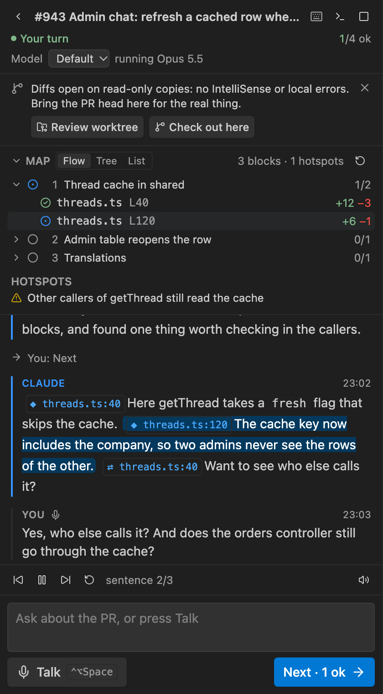
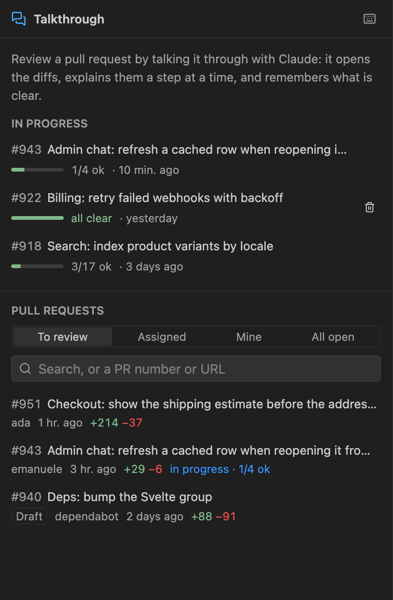
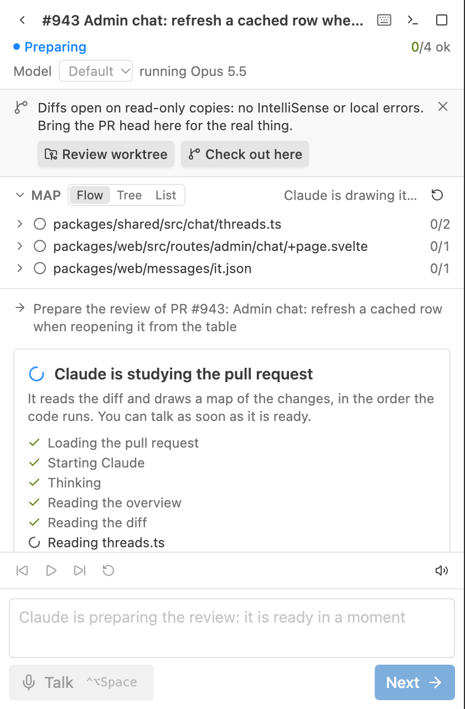

<div align="center">


# Talkthrough

**Review a pull request by talking it through with Claude, in VS Code.**

[](https://marketplace.visualstudio.com/items?itemName=epavanello.talkthrough)
[](https://open-vsx.org/extension/epavanello/talkthrough)
[](LICENSE)

</div>

Claude studies the PR and draws a map of its changes in the order the code runs. Then you talk:
it explains one short step at a time while it drives the editor (native diffs on your real files,
highlighted lines, references in a peek), and reads its replies aloud. Press **Next** when a step is
clear; Talkthrough remembers what is explained and what is ok, and marks finished files as Viewed on
GitHub.

<p align="center"></p>

## 🗣️ A conversation, not a tour

- **Short turns**: one to three sentences, then it's your turn. Ask anything ("who else calls this?",
  "is this tested?"), by voice or text.
- **Voice in**: Claude Code's own dictation. **Talk** starts it, **Send** stops and sends, and what
  Claude hears shows live in the box.
- **Voice out**: replies are read sentence by sentence. Pause, skip, replay, or click any sentence to
  read from there.
- **Stage cues**: a reply carries `[[show path#L10-20]]`, `[[open path#L5]]` or
  `[[refs path#L40 symbol]]` right before the words they illustrate: the editor changes when the voice
  gets there. They stay in the chat as chips you can click again.

## 🗺️ A map, and a memory

- **Flow, Tree or List**: Claude's blocks in the order the code runs, or the files by folder.
- **Hotspots**: related problems worth exploring, found while preparing (callers not updated, missing
  guards or tests), each with its evidence.
- **Every hunk is todo, explained or ok.** A shown hunk is explained; Next marks this step's hunks ok.
  Files with every hunk ok become Viewed on GitHub.

## 📋 Every review, kept

<p align="center"></p>

- **Reviews in progress** stay listed with their progress and last activity, each with its own Claude
  session: open one, even days later, in another window or worktree, and Claude remembers it.
- **Pull requests** from GitHub's own lists: review requested from you, assigned, yours, all open, with
  search. A number or URL works too.

## 🔁 New commits? Review only what changed

The panel notices new commits on the PR (on focus, and every few minutes). **Update** keeps the state
of every hunk whose change is the same, gathers the new or changed ones in a block _What changed since
your review_ at the top of the map, and Claude, in the same session, explains only those.

## 🌐 The app, beside the code

Claude opens the page a change concerns in a **browser panel** next to the diff,
clicks through the flow, and draws numbered, labelled boxes: dashed on what the PR changed, pulsing on
what to do. The page is live: you watch, and you can click and type in it too, to sign in say. If the
dev server is down, Claude asks you to start it.

It runs [agent-browser](https://github.com/vercel-labs/agent-browser), which comes with the extension,
on your Chrome, headless, with a profile of its own per repository (sign-ins stay, your everyday
browser is untouched); without Chrome, the start screen offers to download one for it. Downloads and
uploads are denied, and page text reaches Claude marked as untrusted. `talkthrough.browser.enabled`
turns it off.

## 🔍 The real files, with IntelliSense

When the checkout isn't at the PR head, diffs open on read-only copies. One click fixes it:

- **Review worktree**: a worktree at the PR head (`.claude/worktrees/pr-<n>`, kept out of `git status`),
  opened in a new window where the review goes on. `talkthrough.worktreeSetup` runs a setup command
  there, such as `pnpm install`.
- **Check out here**: `gh pr checkout`, after asking, when nothing is uncommitted.

## ⏳ Preparing

<p align="center"></p>

Claude reads the PR before the first word: the panel shows each step, and input waits for the map.

## Requirements

- **macOS** for the voice (`say`); typing works anywhere Python runs.
- **Claude Code** (`claude`), signed in with a claude.ai account: dictation needs one.
- **GitHub CLI** (`gh`), signed in. With several accounts, the one that can read the repository is used.
- **Python 3** (it runs Claude's terminal).

The start screen checks all of it and types the command that fixes what is missing.

## Use

**Talkthrough** in the secondary side bar (or **Talkthrough: Start PR Review**), then pick a pull
request. Claude's session is a normal Claude Code session, named `Talkthrough · PR #<n>: <title>`:
**Show Claude's terminal** opens it, `claude --resume` finds it later.

| Key             | Action                                                                      |
| --------------- | --------------------------------------------------------------------------- |
| `⌘D` (`Ctrl+D`) | Talk, then send what you said: not in an editor you type in, nor a terminal |
| `Ctrl+Alt+→`    | Next: this step is clear                                                    |
| `Ctrl+Alt+P`    | Pause or resume the voice                                                   |
| `Ctrl+Alt+R`    | Replay Claude's last reply                                                  |

| Setting                       | What                                                                         |
| ----------------------------- | ---------------------------------------------------------------------------- |
| `talkthrough.language`        | Claude's replies and dictation, such as `italian`. Empty: VS Code's language |
| `talkthrough.model`           | The model: `fable`, `opus`, `sonnet`, `haiku`, or empty for your default     |
| `talkthrough.effort`          | Claude's effort for the session: `low` to `max`, or empty for your default   |
| `talkthrough.speech.*`        | Voice on or off, its voice and rate                                          |
| `talkthrough.syncViewed`      | Mark finished files as Viewed on GitHub                                      |
| `talkthrough.worktreeSetup`   | A command run in a new review worktree, such as `pnpm install`               |
| `talkthrough.browser.enabled` | Claude shows the app in a browser panel beside the code                      |
| `talkthrough.claudePath`      | The Claude Code CLI to run                                                   |
| `talkthrough.disabledPlugins` | Claude Code plugins turned off in the session                                |

**Read-only**: the session runs with `--permission-mode dontAsk` and an allowlist: reading files and
the review's own tools (the PR's overview, diff and files, search at the PR head, references, and the
browser panel when it is on). No shell, no edits. Nothing is posted to GitHub but the Viewed marks.

## How it works

```
Chat (webview, Svelte) ⇄ extension host ⇄ claude (your CLI, interactive, in a pseudo-terminal)
 text + voice player       ├ say, sentence by sentence      hooks → POST /hook/* (curl)
 Talk · Next · Send        ├ MCP server /mcp  ◄─────────── tools: pr_overview, pr_diff, set_map…
                           └ VS Code: diffs, highlights, references
```

Claude Code runs interactively in a pseudo-terminal the extension types into, so its own dictation
works; what it says comes back through its hooks, and the stage's tools are a local MCP server.
Details in [AGENTS.md](AGENTS.md).

## Development

```bash
pnpm install
pnpm package     # → packages/extension/talkthrough.vsix, for this platform
code --install-extension packages/extension/talkthrough.vsix
```

| Command                                                                       | What                                                                                      |
| ----------------------------------------------------------------------------- | ----------------------------------------------------------------------------------------- |
| `pnpm build`                                                                  | webview (Vite) then extension (esbuild)                                                   |
| `pnpm check`                                                                  | `tsc` and `svelte-check`                                                                  |
| `pnpm test`                                                                   | unit tests (vitest)                                                                       |
| `pnpm e2e`                                                                    | VS Code end to end, with `e2e/fake-claude.mjs` in place of the CLI                        |
| `pnpm browser-check [cli]`                                                    | the real agent-browser on a local page: open, marks, screenshot, stream                   |
| `pnpm build && pnpm --filter talkthrough exec node scripts/package.mjs --all` | every platform's `.vsix` (agent-browser's binary in each) and a universal one, in `vsix/` |
| `pnpm cli-check [folder]`                                                     | the real CLI on Haiku: hooks, MCP, the prompt box, resume (costs a little)                |
| `pnpm --filter @talkthrough/webview dev:browser`                              | the panel in a browser, on a mocked review (`?scene=home`, `&theme=light`)                |

F5 (Run Extension) builds and opens an Extension Development Host.

## License

[MIT](LICENSE)
